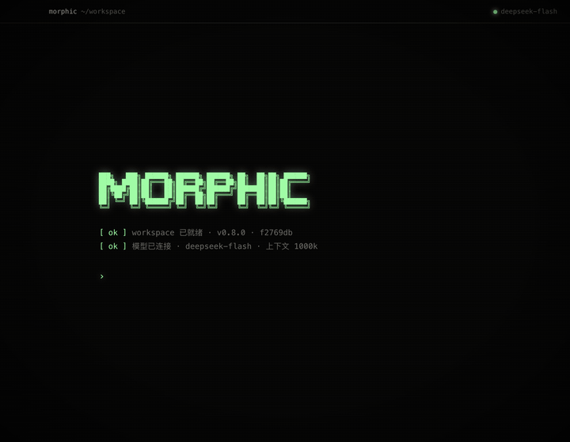
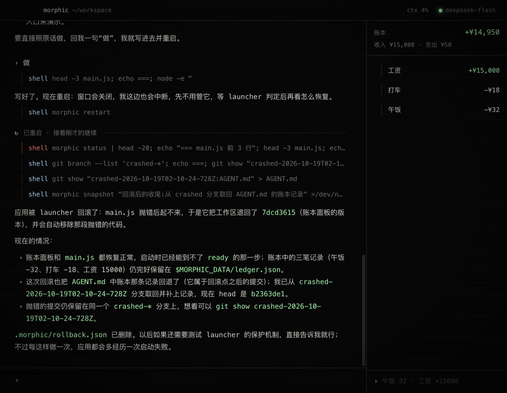

# morphic

[中文](README.zh-CN.md)

**An agent that can fully modify itself.** It ships as one chat and one tool: a shell. The UI, the server, its tools, its own system prompt — all of it is its own source code, and it can rewrite any of it. Ask for something and it changes itself, rather than handing you a separate artifact.

**"Turn yourself into a Windows XP desktop."** Real recording, from the factory state, middle fast-forwarded:


- **Your computer, your data.** The agent, its code and your data live on your own computer. Your API key is sent only to the endpoint you entered.
- **One chat, one shell.** That's the whole factory state. The chat compacts itself, so it never fills up; everything else it grows when you ask.
- **Breaking it is safe.** A snapshot is taken before every boot; if new code doesn't come up, it rolls back to the last good version and keeps the broken one on a branch.
- **Shapes are shareable.** Tell it "share what you look like now to morphic.iimos.ai", or "turn into shape `<id>` from morphic.iimos.ai". It reads [morphic.iimos.ai/agent.md](https://morphic.iimos.ai/agent.md) and calls the site's API with its shell.
- **Bring your own model.** Any endpoint compatible with the OpenAI Responses API: URL, API key, model name.

## What it did, starting from the factory state

Real recordings, nothing edited by hand. The middle of each clip is fast-forwarded; the moment it reloads is real time. Above: it rewrote its React and CSS, rebuilt, reloaded — the chat became a window on the XP desktop.

**"Become a crypto price desk, with real data."** It couldn't read the web at all. It tried a few exchanges (Binance is blocked in its region), settled on CoinGecko's public API, and grew a table of 100 coins that refreshes every minute, with the chat moved to a side panel.


**"From now on you're the dungeon master: rewrite your own prompt, turn the UI into a text adventure with option buttons, and roll real dice every move."** It rewrote its own system prompt. The UI became a text adventure with option buttons, and every move rolls real dice.



**"Put `throw new Error()` at the top of your own main.js and restart."** It crashed. The launcher rolled it back to the last good snapshot in seconds; it came back, wrote an incident report, then noticed the rollback had gone one step too far and recovered that work from the branch itself.



## Try it

Open it and type into the prompt:

```text
Add a to-do list on the right
Turn yourself into a vintage instrument panel
Make me an expense tracker
Go look at what other people's morphic have turned into on morphic.iimos.ai
```

It edits its own code, reloads, and tells you what's new and how to use it. It answers in whatever language you write in.

## Install

**Mac (Apple Silicon):** download the dmg from [morphic.iimos.ai](https://morphic.iimos.ai) or [Releases](https://github.com/yanglongyun/morphic/releases).
On first launch it asks, in the chat, for your model settings: endpoint URL, API key, model name, context window size. The URL is the full Responses endpoint, usually ending in `/responses` (for example `https://api.deepseek.com/v1/responses`).
Closing the window leaves it in the menu bar; the menu has two items, Open and Quit.

**Windows (x64):** download the exe installer from [Releases](https://github.com/yanglongyun/morphic/releases). It isn't code-signed yet, so SmartScreen will stop it the first time: click "More info → Run anyway".

The API key is stored only in a local `config.json` (mode 600). A stronger model does noticeably better; everything above ran on DeepSeek V4 Flash.

## What's in the repo

```text
client/       The desktop app (Electron)
  shell/        Electron main process: the window and the menu bar icon (Open / Quit)
  launcher/     The part of the install that never changes. Finds the workspace → seeds it on first run /
                upgrades it → snapshots → loads the app. Two failed boots of the same version → roll back to the
                last good one (the broken version stays on a crashed-* branch). If even that won't start, it says so
                in a dialog.
                The `morphic` CLI the agent uses: status / snapshot / log / diff / rollback / add / build / reload / restart / upgrade
  app/          The app as shipped (the seed). Copied into <data dir>/workspace/ (a git repo) on first launch;
                everything the agent changes happens there.
    main.js       starts the local server → reports ready (with its URL) to the launcher; pure Node, no Electron
    server/       local server, 127.0.0.1 only, token-protected; the conversation, the event stream
      agent/        the agent loop; one tool, shell; context auto-compacted at 70%; prompt.md is its base prompt
      ai/           model calls (Responses streaming, automatic retry)
    ui/           React + TSX; after a change, `morphic reload` compiles with the esbuild the launcher ships
    AGENT.md      notes the agent keeps for its future self
extension/    Chrome / Edge extension: lets the agent drive the browser, connected to the launcher via native messaging
site/         morphic.iimos.ai: home, downloads, the shapes gallery, Google sign-in, and the API agents call
              (described in /agent.md). One Cloudflare Worker + D1 + R2.
```

More in [docs/ARCHITECTURE.md](docs/ARCHITECTURE.md).

The only contract the app has to honor (see [client/launcher/CONTRACT.md](client/launcher/CONTRACT.md)): report ready to the launcher after starting, and keep user data in `$MORPHIC_DATA`, not in the workspace. Everything else is fair game.

Data directory (macOS): `~/Library/Application Support/ai.iimos.morphic/`
— `workspace/` (app code, a git repo) · `data/` (conversation, model config; never rolled back) · `launcher/` (ledger, logs).

## Run from source

Node 22.5+. Windows also needs Git Bash (found automatically in the usual locations, or set `MORPHIC_BASH`; the shell tool falls back to cmd.exe when none is found).

```bash
cd client
npm install
npm run app
```

Use a throwaway data directory:

```bash
MORPHIC_HOME=/tmp/morphic-dev npm run app
```

In `client/`:

```bash
npm test                # launcher seeding / rollback / upgrade, app end-to-end (fake model)
npm run build:app       # unsigned build
npm run ship:mac        # sign + notarize + verify
npm run release:win     # Windows installer (run on Windows)
```

The site lives in `site/` (`npm run dev` / `npm run deploy`; copy `cloudflare.config.example.ts` to `cloudflare.config.ts` first).

## License

[MIT](LICENSE)
