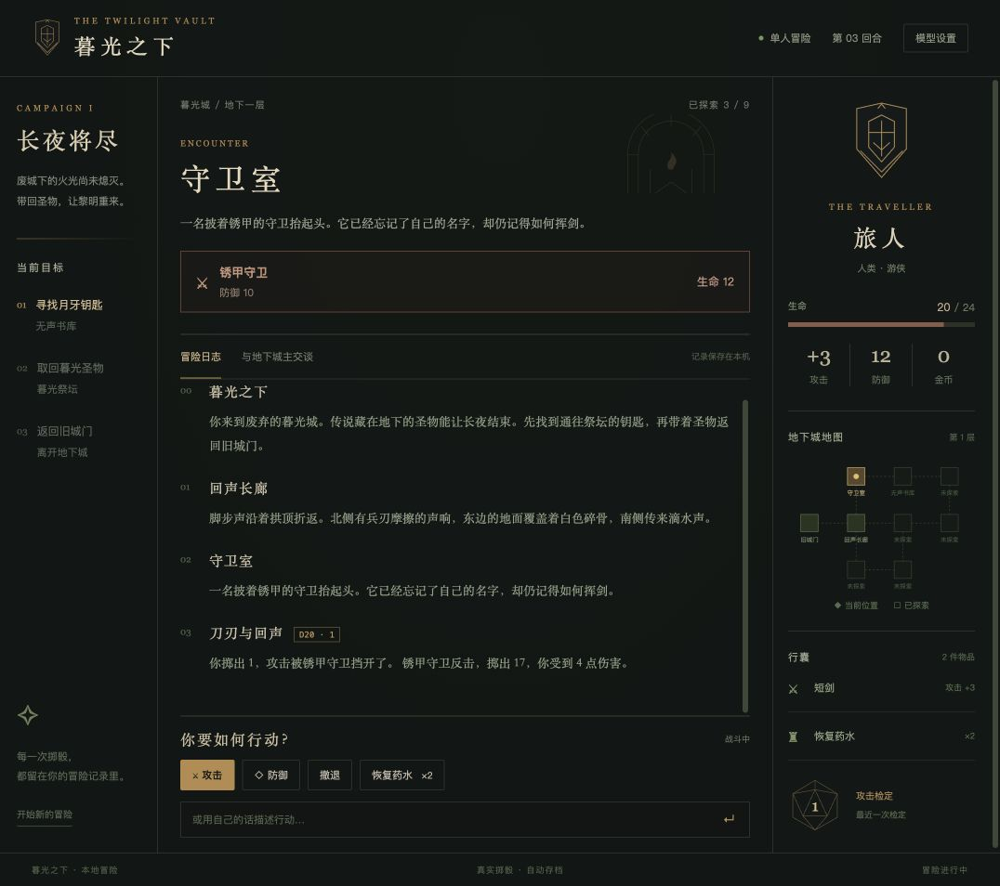

# 暮光之下

地图、角色、战斗和真实掷骰驱动的地下城冒险。无需模型就能探索九个房间，寻找钥匙与圣物，完成冒险。



点击行动按钮移动、战斗、搜寻和使用药水。配置模型后，还可以用自己的话与地下城主交谈。

## 从源码运行

需要 Node.js 22.5+。先在仓库的 `client/` 中执行 `npm install`，然后：

```sh
cd client
IIMOS_SEED=../shapes/development/dungeon IIMOS_HOME=/tmp/iimos-dungeon npm run app
```

在本形态目录中：

```sh
npm run build
npm run check
npm test
IIMOS_DATA=/tmp/iimos-dungeon-data npm start
```

直接启动会打印本机预览地址；经 launcher 启动才有快照和回滚。
模型配置共用 `$IIMOS_DATA/config.json`，本形态的对话和其他数据放在 `$IIMOS_DATA/dungeon/`，与其他形态分开。

源码、编译产物和 [AGENT.md](AGENT.md) 一起在本目录维护。
