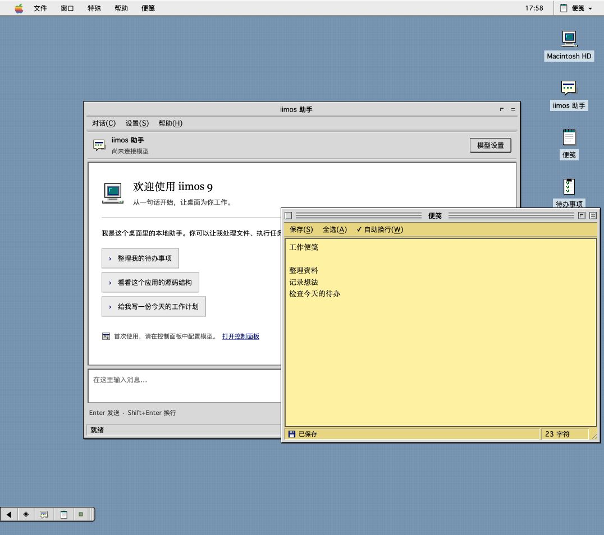

# iimos 9

Mac OS 9 Platinum 经典桌面：顶部菜单栏、条纹标题栏、Finder、黄色便笺、待办事项和本地助手。



双击桌面图标打开应用；用「窗口」菜单或右上角应用切换器恢复隐藏的窗口。

## 从源码运行

需要 Node.js 22.5+。先在仓库的 `client/` 中执行 `npm install`，然后：

```sh
cd client
IIMOS_SEED=../shapes/development/macos9 IIMOS_HOME=/tmp/iimos-macos9 npm run app
```

在本形态目录中：

```sh
npm run build
npm run check
npm test
IIMOS_DATA=/tmp/iimos-macos9-data npm start
```

直接启动会打印本机预览地址；经 launcher 启动才有快照和回滚。
模型配置共用 `$IIMOS_DATA/config.json`，本形态的对话和其他数据放在 `$IIMOS_DATA/macos9/`，与其他形态分开。

源码、编译产物和 [AGENT.md](AGENT.md) 一起在本目录维护。
