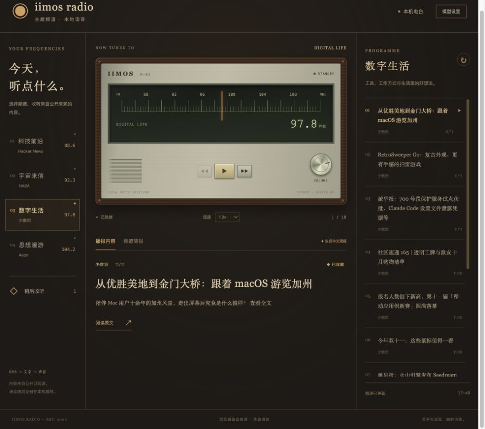

# iimos 电台

木壳复古收音机外观的主题频道：接收 Hacker News、NASA、少数派和 Aeon 的真实 RSS 内容，支持语音朗读、收藏与模型简报。



选择频道或拖动调频刻度，点击播放开始朗读。稍后收听保存在本机。中文简报需要配置模型。

## 从源码运行

需要 Node.js 22.5+。先在仓库的 `client/` 中执行 `npm install`，然后：

```sh
cd client
IIMOS_SEED=../shapes/development/radio IIMOS_HOME=/tmp/iimos-radio npm run app
```

在本形态目录中：

```sh
npm run build
npm run check
npm test
IIMOS_DATA=/tmp/iimos-radio-data npm start
```

直接启动会打印本机预览地址；经 launcher 启动才有快照和回滚。
模型配置共用 `$IIMOS_DATA/config.json`，本形态的对话和其他数据放在 `$IIMOS_DATA/radio/`，与其他形态分开。

源码、编译产物和 [AGENT.md](AGENT.md) 一起在本目录维护。
