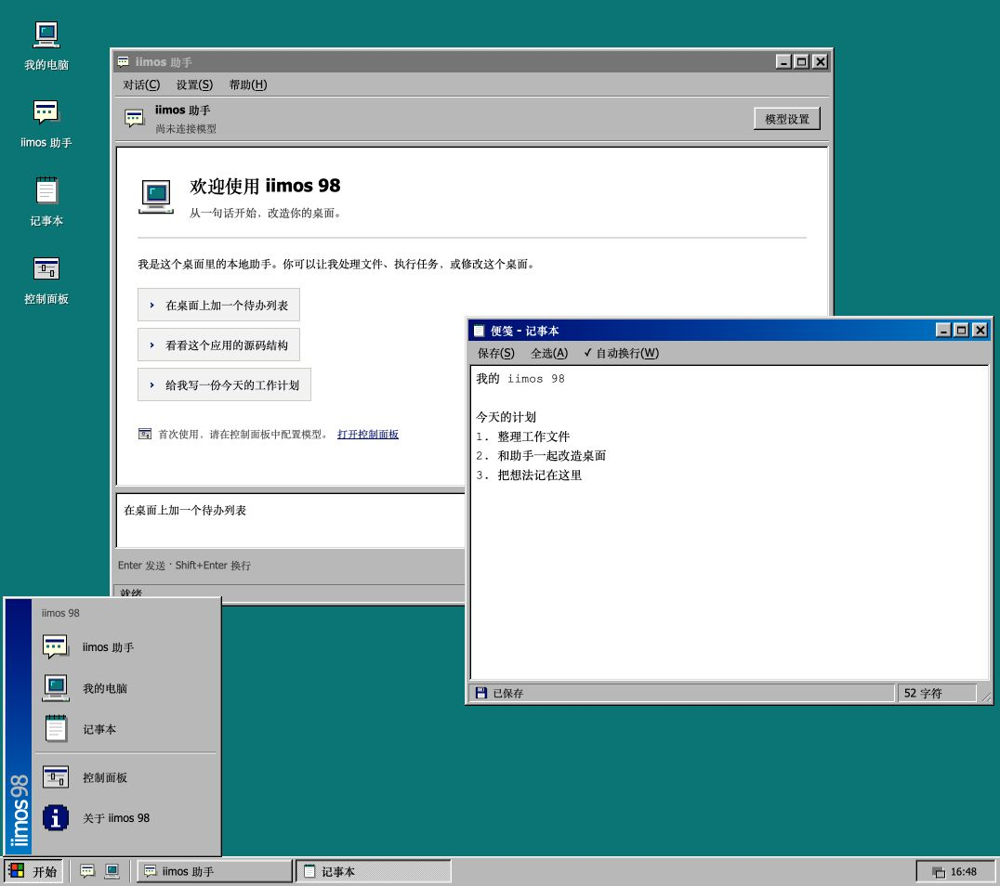

# iimos 98

Windows 98 经典外观的 iimos 形态：青绿色桌面、像素图标、灰色立体窗口、蓝色标题栏、开始菜单和任务栏。



- **桌面窗口**：拖动、八向缩放、最小化、最大化、还原、关闭和任务栏切换。
- **iimos 助手**：本地对话、流式回复、shell 工具、上下文自动压缩和重启接续。
- **我的电脑**：浏览应用源码和我的文档，支持文件夹导航、图标/列表视图和文本预览。
- **记事本**：便笺自动保存到本机；Ctrl/Cmd+S 可立即保存，多窗口修改冲突时保留当前草稿。
- **控制面板**：配置 Responses 服务地址、API Key、模型和上下文窗口。

## 开发

需要 Node.js 22.5+，先在仓库的 `client/` 安装开发依赖。

```sh
cd client
npm install
IIMOS_SEED=../shapes/development/win98 IIMOS_HOME=/tmp/iimos-win98 npm run app
```

在本目录中：

```sh
npm run build    # 使用 launcher 工具链编译 ui/src → ui/dist
npm run check    # TypeScript 检查
npm test         # Agent、窗口行为、文件访问和便笺持久化测试
npm start        # 单独启动本地服务，打印界面地址
```

单独启动时没有 launcher 的快照、回滚和系统能力。可使用 `IIMOS_DATA=/tmp/iimos-win98-data npm start` 隔离数据。

## 数据

模型配置使用所有形态共用的 `$IIMOS_DATA/config.json`。本形态的对话和文档单独放在 `$IIMOS_DATA/win98/`；便笺是 `documents/note.txt`。
关闭窗口不会停止正在运行的助手。关闭或最小化助手后，通过任务栏或快速启动按钮继续对话。

源码、编译产物与 [AGENT.md](AGENT.md) 在本目录一并维护。
